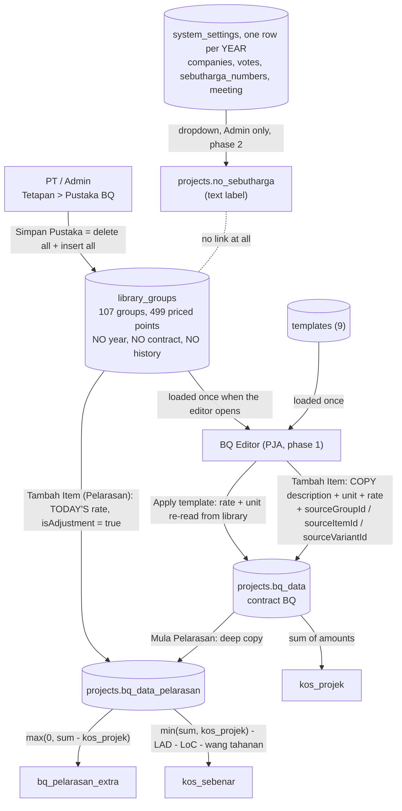
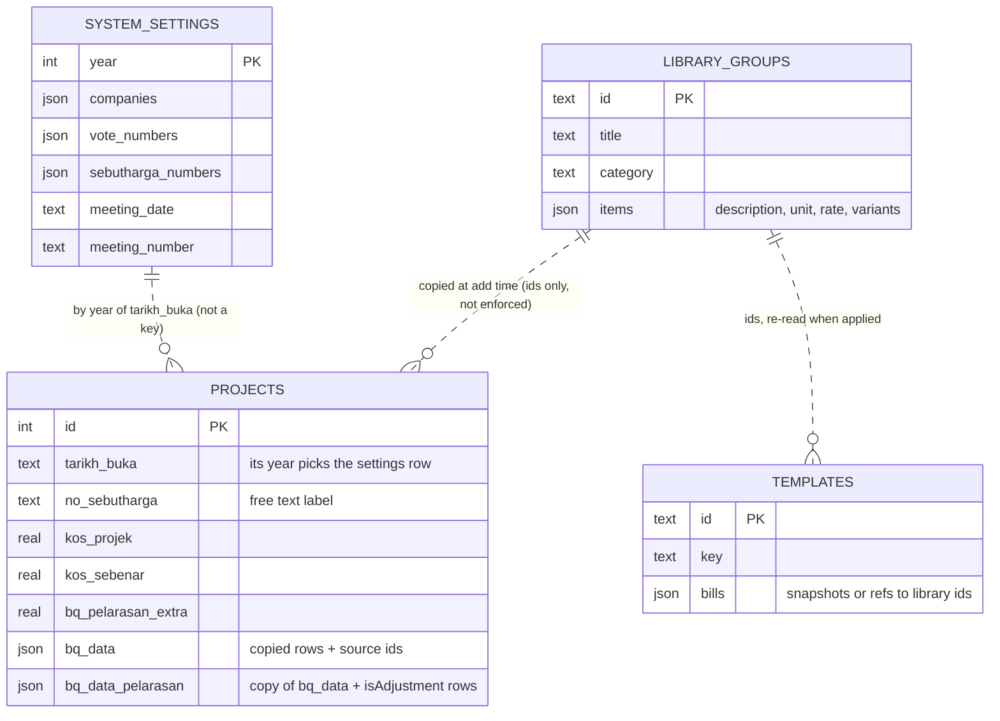
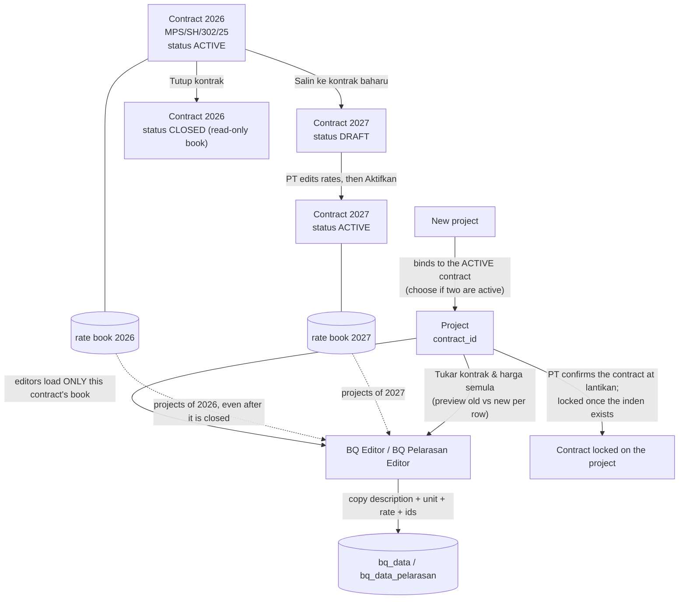
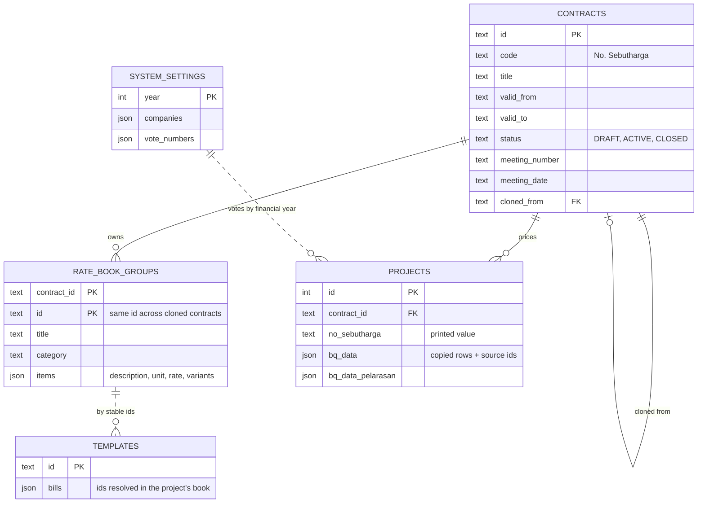

# InfraHub — the BQ item / "master BQ" / contract problem

Source of every number: the LOCAL copy of D1 (snapshot of 2026-11-20 06:46 +08), never production.
Scripts and raw outputs: `work/bq/raw/` (`analyze_bq.py`, `analyze_bq_extra.py`, `x*.json` SQL cross-checks).
Labels used below: **VERIFIED** = proven by a file:line or a query in this round. **INFERENCE** = my reading of how
public-works panel contracts normally work; the owner must confirm it.

---

## Summary

- **The master BQ is a price list with no owner contract.** `library_groups` has exactly four columns
  (`id, title, category, items`): no year, no sebutharga, no date, no version (VERIFIED, `schema.sql:28-33`,
  `PRAGMA table_info`). Saving the Pustaka deletes every row and re-inserts it, so the previous rates are gone
  for good (`functions/api/repositories/SystemRepository.ts:48-56`).
- **Projects are already safe copies, which is the good news.** When a PJA picks an item, InfraHub copies the
  description, unit and rate into `projects.bq_data`. Nothing ever re-reads the library for rows that already
  exist. Of 8,672 BQ item rows, 100% carry a library link, 8,321 (95.95%) still equal today's library rate, only
  20 rows (0.23%, in 9 projects) differ, and 331 rows (3.82%, in 171 projects) point to library groups that have
  since been deleted and still print and total correctly.
- **The danger is everything that happens AFTER the rates change.** The library is re-read every time someone
  presses *Tambah Item*, applies a template, or adds a BQ Pelarasan item. There is no status lock on the contract
  BQ. So the day the PT types next year's rates into the Pustaka, every still-open project starts mixing two
  contracts' rates silently. Today 194 projects of 2026 are not yet SIAP (about RM 5.72 million), 128 of them have
  not started their BQ Pelarasan, and 63 have a priced BQ but no contractor and no sebutharga yet.
- **InfraHub has only ever lived under one contract, so the problem has not bitten yet.** 420 of the 422
  projects that have a sebutharga number carry the same one (`MPS/SH/302/25`). `no_sebutharga` is a text label
  chosen by the Admin in phase 2, after the PJA has already priced the BQ in phase 1; it is not connected to
  the rates in any way.
- **Recommendation: make the contract a real thing (option B, "rate book per contract").** One sebutharga = one
  rate book. A project is tied to one contract; its editors (BQ and BQ Pelarasan) read only that contract's
  book; a new year starts with *Salin ke kontrak baharu*; a closed contract's book becomes read-only but stays
  available to its own projects. No existing project BQ has to be rewritten. Before the next contract arrives,
  two small safety steps (archive the current rate book, stamp every project with its contract) should be done
  first.

---

## How it works today

### 1. Where the master BQ lives (VERIFIED)

| Piece | Where | What it does |
|---|---|---|
| Table | `schema.sql:28-33` `library_groups(id, title, category, items JSON)` | 107 groups, each with a JSON list of items; an item has `description`, `unit`, `rate` and optional `variants[]` (`id, label, unit, rate`) — `types.ts:39-59` |
| API | `functions/api/routes/system.ts:27-39` `GET` / `PUT /api/system/library_groups` | read all / replace all |
| Repository | `functions/api/repositories/SystemRepository.ts:38-56` | `SELECT * FROM library_groups`; save = `DELETE FROM library_groups` then one `INSERT` per group |
| Client | `services/apiService.ts:129-135` | `getLibraryGroups()`, `saveLibraryGroups()` |
| Admin screen | `pages/AdminSettings.tsx:227, 271, 424-447, 983-1017` ("Pengurusan Pustaka BQ", button *Simpan Pustaka*) and `components/admin/settings/Library*.tsx` | the PT edits groups, items, variants, rates; can move items between groups (`:471-488`), delete items (`:652-654`), export to Excel (`lib/bqExport.ts:246-281`) |
| Year settings | `schema.sql:132-142` `system_settings` (one row per **year**) via `hooks/useSettings.ts:5-66` | companies, vote numbers, sebutharga numbers, meeting date/number. **The library is not in here**: it is global |

Size today: 107 groups, 196 items, 358 variants = **499 priced points** in 17 categories. No priced point has a
zero rate.

### 2. Templates (VERIFIED)

`templates(id, key, title, subtitle, icon, color, bills JSON, group_refs JSON, order_index)` — `schema.sql:36-46`.
A template bill holds either

- **legacy references** `{groupId, itemId, variantId}` (the three `PERMULAAN_BASIC` insurance-band templates:
  3 references each), resolved against the library at the moment the template is used
  (`pages/BQEditor.tsx:633-672`); or
- **full item snapshots** (the 5 `CUSTOM` templates such as LONGKANG, LALUAN KELUAR/MASUK, HENTIAN BAS, ROAD
  MARKING: 32 item rows in total), which keep `sourceGroupId/sourceItemId/sourceVariantId`. When such a template
  is applied, **rate and unit are overwritten with the library's current values** if the link still resolves
  (`pages/BQEditor.tsx:598-613`); the description is kept from the template. If the link no longer resolves, the
  template's own stored rate is used silently.

`group_refs` is empty in all 9 templates (legacy column). A PJA can save a bill as a new template
(`pages/BQEditor.tsx:691-761`); that also re-reads the library rate into the template (`:720-733`).

### 3. How a PJA adds an item (VERIFIED)

1. The BQ editor loads the whole library and all templates **once, when the page opens**
   (`pages/BQEditor.tsx:171-184`).
2. *Tambah Item* opens the library picker (`:323-327`). There is no "blank manual item" button: every item
   starts from the library. That is why 100% of the 8,672 item rows carry `sourceItemId`.
3. `handleLibraryAddItem` (`:375-441`) calls `createItem` (`data/bqPresets.ts:3-113`), which **copies**:
   - `description` = the variant label if a variant was picked, otherwise the item description
     (the parent item text and the group title become HEADER rows, `:392-431`);
   - `unit` and `rate` from the variant or the item;
   - starting quantity logic from the unit (m / m² / m³);
   - plus the three link fields `sourceGroupId`, `sourceItemId`, `sourceVariantId` (`:432-441`).
4. `amount = qty × rate`, rounded to 2 decimals, is stored on the row (`:471`).
5. After that the row is self-contained. The PJA can still **type over the description and the rate**
   (`pages/BQEditor.tsx:1197-1198`; the rate box is only disabled when the whole editor is read-only).
6. The contract BQ has **no status lock**: the editor is read-only only for a different PJA or while syncing
   (`pages/ProjectDetail.tsx:521, 1477`). It can be edited in any status, including after lantikan.

### 4. Does anything re-read the library for an existing project? (VERIFIED)

| Moment | Re-reads library? | Evidence |
|---|---|---|
| Opening a saved project | Only to fill the picker. Existing rows are untouched (numbers are just normalised) | `pages/BQEditor.tsx:81-116, 171-184` |
| Adding a new item to an old project | **Yes, today's rate** | `pages/BQEditor.tsx:375-441` |
| Applying a template | **Yes, today's rate and unit** | `pages/BQEditor.tsx:598-613, 659` |
| Saving a bill as a template | Yes, into the template only | `pages/BQEditor.tsx:720-733` |
| BQ Pelarasan: adding an item or a template | **Yes, today's rate** (`isAdjustment = true`) | `pages/BQPelarasanEditor.tsx:181-252, 596-613, 638-642` |
| Saving, changing status, printing PDFs | No. No project or PDF code mentions the library at all | `grep -n library functions/api/repositories/ProjectRepository.ts functions/api/routes/projects.ts services/pdf/*.ts` returns nothing |

There is **no "refresh rates" action**, and no code path that updates an existing row from the library.

### 5. BQ Pelarasan (VERIFIED)

- *Mula Pelarasan* makes a **deep copy** of the contract BQ: `JSON.parse(JSON.stringify(formData.bqData))`
  into `bqDataPelarasan` (`pages/ProjectDetail.tsx:594-611`). From then on the two are separate documents.
- Carried-over rows keep the contract rate and description; they are shown as plain text, only the quantity
  can change (`pages/BQPelarasanEditor.tsx:985-1001`). Each row is compared with the contract row that has the
  same `id` (`:889-899`).
- New rows added during pelarasan are flagged `isAdjustment: true` (`:241-252`), shown in blue, and their
  description, unit and rate are editable (`:985-999`). Their rate comes from **the library as it is on that
  day**, not from the project's contract.

### 6. The cost columns (VERIFIED)

| Column | Formula | Evidence |
|---|---|---|
| `kos_projek` (Harga Kontrak) | sum of `amount` of every row in `bq_data` | `pages/ProjectDetail.tsx:942-954` |
| `bq_pelarasan_extra` | `max(0, sum(bq_data_pelarasan) − kos_projek)` | `pages/ProjectDetail.tsx:835, 847` |
| `kos_sebenar` (Harga Akhir) | `min(sum(bq_data_pelarasan), kos_projek) − LAD − LoC − wang tahanan`, floored at 0 | `pages/ProjectDetail.tsx:808-850` |
| "Harga Akhir" in lists | `kos_projek` before TUNTUTAN_BAYARAN, `kos_sebenar` after | `pages/ProjectsList.tsx:322-339` |

So the pelarasan total is **capped at the contract price**; the overflow is kept separately. These are computed
in the browser when the project page is open and saved with the project.

### 7. Where year, sebutharga, companies and votes are used (VERIFIED)

- A project's year = the year of `tarikh_buka` (`entries/projects.tsx:17-18`; `pages/ProjectDetail.tsx:224-225`).
  That year decides which company list, vote list and sebutharga list the project page shows.
- `no_sebutharga` is a dropdown filled from that year's `sebutharga_numbers`, editable by the Admin only
  (`pages/ProjectDetail.tsx:522, 1088-1089`); it sits in the phase-2 (PT) block (`:1488, 1513`).
- It is printed on the CPC (`pages/CPCCertificate.tsx:107`, `services/pdf/CPCPDFExporter.ts:92`) and on notices
  (`services/pdf/NotisPDFExporter.ts:717`), and is an optional list column (`pages/ProjectsList.tsx:196, 1157`).
- The BQ PDF prints the year's Jawatankuasa Sebutharga meeting number and date
  (`services/pdf/BQPDFExporter.ts:82-83, 191`), also from the per-year settings.
- The list of sebutharga numbers is maintained per year in Settings (`pages/AdminSettings.tsx:349-350, 399-401,
  886`).

Nothing connects `no_sebutharga` to a rate. It is a label on the paperwork.

### 8. What happens when the Admin edits or deletes a rate today (VERIFIED from code, consistent with the data)

| Admin action | Saved projects | The next click in any project |
|---|---|---|
| Changes a rate | Unchanged. Stored rows keep the old rate (20 rows prove it: they differ from the library today) | *Tambah Item*, a template, or a pelarasan addition uses the new rate, in any year and any status |
| Rewords a description or unit | Unchanged (200 rows differ in description, 133 in unit) | New rows get the new text |
| Deletes or re-creates a group or item | Unchanged. The row keeps printing; its link is dead (331 rows) | The item is no longer offered |
| Presses *Simpan Pustaka* | — | The old library is deleted and replaced. No copy is kept, no date is recorded. An editor page that was already open keeps the library it loaded until it is reloaded |

**Rate versioning, effective dates, contract id: none exist anywhere** (`schema.sql:28-33`; the only
contract-like columns on `projects` are `no_sebutharga`, `tempoh_kontrak`, `tarikh_mula_kontrak`,
`tarikh_tamat_kontrak`, `is_manual_mula_kontrak`, `cover_sebut_harga_text` — query `x6`).

Reliability note: the save is a delete followed by 107 separate inserts with no transaction
(`SystemRepository.ts:48-56`). If it stops halfway, part of the master BQ is lost, and there is no earlier
version to restore from.

### Current flow





---

## Measurements

All counts are aggregates over the local copy. "Item row" = a row of `type: ITEM` inside `bq_data`
(headers are not counted). SQL cross-checks of the Python counts are in `REPORT-bq.md`.

### M1. Volume per year and status

488 of 489 projects have a BQ: 1,734 bills, **8,672 item rows** (plus 13,745 header rows). A project has a
median of 17 item rows (90% have 27 or fewer, maximum 37).

```csv
year,status,projects,with_bq,with_pelarasan,bills,item_rows,linked,custom,linked_found_in_library,rate_same_as_library,rate_differs,unit_differs,description_differs,orphan_group,orphan_item,orphan_variant,bq_amount_rm
2025,MENUNGGU_LANTIKAN,1,1,0,4,17,17,0,15,15,0,0,0,2,0,0,7802.45
2025,DALAM_PROSES,1,1,0,1,3,3,0,3,3,0,0,0,0,0,0,1870.0
2025,SIAP,2,2,2,8,36,36,0,34,34,0,0,9,2,0,0,42143.91
2026,FASA_DRAF,29,28,0,87,393,393,0,393,392,1,3,5,0,0,0,2226644.01
2026,MENUNGGU_LANTIKAN,34,34,0,119,632,632,0,632,632,0,7,26,0,0,0,1046821.06
2026,DALAM_PROSES,53,53,6,185,872,872,0,865,864,1,3,7,7,0,0,1594100.27
2026,PEMERIKSAAN_TAPAK,32,32,14,115,565,565,0,554,554,0,4,17,11,0,0,996845.13
2026,TUNTUTAN_BAYARAN,46,46,46,170,838,838,0,795,795,0,18,21,43,0,0,1336835.2
2026,SIAP,291,291,290,1045,5316,5316,0,5050,5032,18,98,115,266,0,0,8098687.89
ALL,ALL,489,488,358,1734,8672,8672,0,8341,8321,20,133,200,331,0,0,15351749.92
```

Caution on money: the FASA_DRAF total contains one draft row with a stored rate of RM 1,484,384.57 for an item
whose library rate is RM 120.70 (almost certainly a typing slip in a draft). Without that single row the grand
total is RM 13,867,365.35, and the open 2026 projects total RM 5,716,861.10.

### M2. Library-linked vs manual, and agreement with today's library

```csv
class,item_rows,pct_rows,amount_rm,pct_amount
"linked, rate = library today",8321,95.95,13793703.25,89.85
"linked, rate differs from library today",20,0.23,1558046.67,10.15
"linked, library entry gone (orphan)",331,3.82,,
custom / manual (no library link),0,0.0,0,0.0
```

- **0 manual rows.** Every item row has a `sourceItemId` (SQL check `x2`). The editor has no blank-item button;
  "custom" work is done by typing over a library row.
- 8,341 rows still resolve in the library; **8,321 of them (99.76%) equal today's rate**.
- 479 of 488 projects have no row that disagrees with today's library rate (orphan rows aside); 9 projects hold the 20 differing rows.
- The RM column for "rate differs" is dominated by the one draft outlier above; without it the 19 remaining
  rows are worth RM 73,662.10 as stored versus RM 31,351.63 at today's library rates.

The 20 rows whose stored rate is not today's library rate (no identities):

```csv
year,status,project_created,category,library_point,stored_rate,library_rate_today,ratio,qty,stored_amount,amount_at_library_rate_today
2026,FASA_DRAF,2026-03,KPK,Kerja-kerja membekal dan memasang pele,1484384.57,120.7,12298.132,1.0,1484384.57,120.7
2026,SIAP,2026-03,KPK,Lot petak & Nombor petak ,37870.0,17.0,2227.647,1.0,37870.0,17.0
2026,SIAP,2026-07,Scupper Drain,Kerja-kerja pembinaan Scupper Drain me,204.0,107.99,1.889,85.0,17340.0,9179.15
2026,SIAP,2026-03,Longkang,100mm tebal (Tuang Disitu),37.99,50.61,0.751,70.0,2659.3,3542.7
2026,SIAP,2026-03,Longkang,100mm tebal (Tuang Disitu),37.99,50.61,0.751,70.0,2659.3,3542.7
2026,SIAP,2026-03,Longkang,100mm tebal (Tuang Disitu),26.07,50.61,0.515,30.0,782.1,1518.3
2026,SIAP,2026-03,Longkang,100mm tebal (Tuang Disitu),26.07,50.61,0.515,30.0,782.1,1518.3
2026,SIAP,2026-03,Permulaan,KERJA-KERJA PENGUKURAN UNDERGROUND MAP,8.5,12.75,0.667,150.0,1275.0,1912.5
2026,SIAP,2026-03,Laluan Keluar Masuk,100mm tebal (Tuang Disitu),26.07,50.61,0.515,22.5,586.58,1138.72
2026,SIAP,2026-03,Longkang,Kerja-kerja mengalihkan tiang Telekom/,3000.0,2500.0,1.2,1.0,3000.0,2500.0
2026,SIAP,2026-03,Longkang,225mm,30.6,23.04,1.328,50.0,1530.0,1152.0
2026,DALAM_PROSES,2026-08,Papan Tanda,KANAK-KANAK MELINTAS - Size 600mm x 60,467.1,587.1,0.796,2.0,934.2,1174.2
2026,SIAP,2026-03,Longkang,900mm x 900mm,1028.5,822.8,1.25,1.0,1028.5,822.8
2026,SIAP,2026-03,Longkang,225mm,30.6,23.04,1.328,25.0,765.0,576.0
2026,SIAP,2026-03,Longkang,225mm,30.6,23.04,1.328,25.0,765.0,576.0
2026,SIAP,2026-03,Permulaan,"Bagi nilai kerja diantara RM25,000.00 ",340.0,510.0,0.667,1.0,340.0,510.0
2026,SIAP,2026-03,Laluan Keluar Masuk,100mm tebal (Tuang Disitu),26.07,50.61,0.515,6.0,156.42,303.66
2026,SIAP,2026-03,Longkang,"Nilai Kerja RM20,000.01 sehingga RM50,",340.0,425.0,0.8,1.0,340.0,425.0
2026,SIAP,2026-03,Longkang,500mm,42.43,47.13,0.9,10.0,424.3,471.3
2026,SIAP,2026-03,Longkang,500mm,42.43,47.13,0.9,10.0,424.3,471.3
```

Reading (INFERENCE): 18 of the 20 sit in projects whose record was created in March 2026, the month most
records were entered. Several repeat the same old value (26.07 four times, 30.60 three times), which looks like
the library being corrected after those BQs were built. Two rows (ratio above 2,000) look like a lump-sum price
typed into the rate box. Either way the code cannot tell which, because nothing records why a rate differs.

```csv
created_month,linked_items,rate_differs,pct_differs
2026-03,2946,18,0.61
2026-04,874,0,0.0
2026-05,748,0,0.0
2026-06,507,0,0.0
2026-07,949,1,0.11
2026-08,792,1,0.13
2026-09,522,0,0.0
2026-10,593,0,0.0
2026-11,410,0,0.0
```

### M3. Description and unit drift

- Description differs from the library in 200 rows (255 if spacing and capitals are counted). 121 of the 200
  share their "different" wording with at least one other project (the library text was probably edited after
  the copy: INFERENCE); 72 are one-off edits.
- Unit differs in 133 rows:

```csv
unit_stored_in_project,unit_in_library_today,item_rows
m²,m2,65
m,m²,18
m³,m²,18
m³,m3,18
m²,m³,5
m²,m,4
m³,m,2
m,m³,1
m²,m3,1
m³,m2,1
```

The top line (`m²` stored, `m2` in the library today) is the same unit spelled two ways, again pointing to a
library edit that did not, and cannot, reach existing rows.

### M4. Orphans (rows whose library entry no longer exists)

```csv
what_happened_to_the_library_entry,project_item_rows
item_id_not_in_library_at_all (deleted or re-keyed),287
variant_id_still_exists_under_another_item,44
```

331 rows in 171 projects (RM 464,549.25) point to 11 group ids that are no longer in the library. For 287 the
item id is nowhere in the library; for 44 the variant id now lives under a different item (the library was
restructured). No row points to a surviving group with a missing item. These rows print and total normally;
what is lost is traceability, and they would not survive any future "re-price from the library" feature without
a mapping.

### M5. Do different projects use different rates for the same item? (rate drift)

```csv
distinct_rates_seen_across_projects,library_points
1,324
2,12
3,1
```

337 distinct library points appear in project BQs. **324 have exactly one rate across every project and all
~60 panel companies**; 12 have two rates; 1 has three. The deviations are the same 20 rows as in M2.
VERIFIED consequence: there is no sign of per-contractor rates. One schedule priced everybody.

```csv
library_point,uses,distinct_rates,min_rate,max_rate,library_rate_today,modal_rate,uses_not_at_modal
KONKRIT / 100mm tebal (Tuang Disitu),539,3,26.07,50.61,50.61,50.61,4
LONGKANG JENIS TEMBIKAR (CLAY) / 225mm,496,2,23.04,30.6,23.04,23.04,3
"KERJA-KERJA AKHIR / Nilai Kerja RM20,000.01 sehingga RM50,00",443,2,340.0,425.0,425.0,425.0,1
"INSURANS / Bagi nilai kerja diantara RM25,000.00 hi",314,2,340.0,510.0,510.0,510.0,1
KONKRIT / 100mm tebal (Tuang Disitu),218,2,26.07,50.61,50.61,50.61,2
? / (gone),69,2,110.46,177.65,,177.65,1
STRUCT / 500mm,40,2,42.43,47.13,47.13,47.13,2
SUMP / 900mm x 900mm,15,2,822.8,1028.5,822.8,822.8,1
KERJA-KERJA PENGUKURAN / KERJA-KERJA PENGUKURAN UNDERGROUND MAPPI,13,2,8.5,12.75,12.75,12.75,1
PEMBINAAN SCUPPER DRAIN / Kerja-kerja pembinaan Scupper Drain meng,7,2,107.99,204.0,107.99,107.99,1
PAPAN TANDA KESELAMATAN/PEMBERITAHUAN JA / KANAK-KANAK MELINTAS - Size 600mm x 600m,6,2,467.1,587.1,587.1,587.1,1
PELEKAT PANTULAN CAHAYA / Kerja-kerja membekal dan memasang peleka,2,2,120.7,1484384.57,120.7,120.7,1
```

Usage is concentrated: 285 of the 499 current priced points have been used at least once (214 never), and just
26 points account for 80% of all item rows.

```csv
category,item_rows,amount_rm_excl_outlier
Longkang,4380,7405364.83
Permulaan,1484,1189296.73
Laluan Keluar Masuk,1086,1152961.77
(library group gone),331,464549.25
Jentera,249,238809.4
Garisan Jalan,240,483449.93
Papan Tanda,215,701260.71
Perhentian Bas,196,414590.14
Penutup Longkang,183,549808.77
Jalan,86,260233.0
Susur Jalan (Road Kerb),56,110218.14
"Pagar, Railling & Guardrail",50,486090.08
Pejalan Kaki,42,47257.69
Scupper Drain,24,102054.93
Geoteknikal,20,65997.7
Pelbagai,18,43770.41
KPK,6,114591.0
Palang Penghadang,6,37060.87
```

```csv
category,groups,items,priced_points
Longkang,18,22,83
Perhentian Bas,17,39,39
Pelbagai,11,18,26
"Pagar, Railling & Guardrail",8,21,23
Geoteknikal,7,12,12
Papan Tanda,6,15,62
Scupper Drain,6,11,13
Laluan Keluar Masuk,4,5,16
Garisan Jalan,4,7,31
Penutup Longkang,4,7,107
Permulaan,4,7,15
KPK,3,3,3
Palang Penghadang,3,3,23
Pejalan Kaki,3,7,12
Jalan,3,8,8
Jentera,3,3,18
Susur Jalan (Road Kerb),3,8,8
```

### M6. BQ Pelarasan

```csv
year,status,projects_with_pelarasan,item_rows,isAdjustment_items,projects_with_adjustment,adj_linked,adj_custom,adj_linked_rate_differs_from_library,carried_items_rate_ne_contract_bq,carried_items_not_in_contract_bq,contract_items_missing_in_pelarasan,pelarasan_amount_rm,adjustment_amount_rm
2025,SIAP,2,36,0,0,0,0,0,0,0,0,50844.48,0
2026,DALAM_PROSES,6,96,1,1,1,0,0,0,0,0,173665.12,1049.75
2026,PEMERIKSAAN_TAPAK,14,240,19,3,19,0,0,0,0,0,424167.88,10816.14
2026,TUNTUTAN_BAYARAN,46,903,65,23,65,0,0,0,0,0,1349199.41,70392.46
2026,SIAP,290,5716,404,130,404,0,0,0,4,7,8148034.61,537438.95
ALL,ALL,358,6991,489,157,489,0,0,0,4,7,10145911.5,619697.3
```

- 358 projects have a pelarasan BQ (6,991 item rows).
- **489 rows are `isAdjustment`** (added during pelarasan) in 157 projects, worth RM 619,697.30. All are
  library-linked; none differs from today's library rate; 28 point to deleted groups.
- Of 6,498 carried-over rows, **0 have a rate different from the contract BQ** and 3,474 (53%) have a changed
  quantity. The copy semantics hold.
- 4 carried rows no longer exist in the contract BQ and 7 contract rows are missing from the pelarasan: the
  contract BQ was edited after the pelarasan copy was made (possible because nothing locks it).

```csv
category,isAdjustment_items
Longkang,264
Laluan Keluar Masuk,88
Penutup Longkang,38
Jentera,33
(library group gone),28
Garisan Jalan,16
Papan Tanda,11
Pejalan Kaki,3
Susur Jalan (Road Kerb),2
Jalan,2
Pelbagai,2
Geoteknikal,1
"Pagar, Railling & Guardrail",1
```

```csv
outcome,projects
pelarasan total below contract,87
pelarasan total equals contract,29
pelarasan total above contract (capped; overflow stored),242
```

In 242 of 358 projects the measured total exceeds the contract price and is capped; the stored overflow
(`bq_pelarasan_extra`) adds up to RM 251,467.52 across 233 projects.

### M7. Cost columns agree with the BQ

- `kos_projek` = sum of BQ amounts in 488 of 488 projects.
- `kos_sebenar` matches its formula in 358 of 358 projects with a pelarasan.
- `bq_pelarasan_extra` matches in 349 of 358; the 9 exceptions are SIAP projects where the column is 0 but the
  formula gives RM 76.92 to RM 6,872.56 (a stale stored value; it does not affect `kos_sebenar`).

### M8. Sebutharga numbers

```csv
no_sebutharga,projects
MPS/SH/302/25,420
(empty),67
MPS/SH/2025/001,1
MPS/25/25/25,1
```

```csv
year,status,no_sebutharga,projects
2025,MENUNGGU_LANTIKAN,(empty),1
2025,DALAM_PROSES,(empty),1
2025,SIAP,MPS/25/25/25,1
2025,SIAP,MPS/SH/2025/001,1
2026,FASA_DRAF,(empty),29
2026,MENUNGGU_LANTIKAN,(empty),34
2026,DALAM_PROSES,MPS/SH/302/25,53
2026,PEMERIKSAAN_TAPAK,MPS/SH/302/25,32
2026,TUNTUTAN_BAYARAN,MPS/SH/302/25,46
2026,SIAP,(empty),2
2026,SIAP,MPS/SH/302/25,289
```

```csv
year,panel_companies,vote_numbers,sebutharga_numbers
2024,0,0,0
2025,3,6,1
2026,60,10,1
```

- 3 distinct values. 420 projects share `MPS/SH/302/25`. The two other values belong to the 4 projects dated
  2025 (one of them is not in the 2025 settings list; they look like early trial records: INFERENCE).
- **All 63 projects in FASA_DRAF and MENUNGGU_LANTIKAN have a priced BQ but no sebutharga and no company.** The
  BQ is priced before the contract is chosen.

### M9. Exposure: who is affected the day the rates change

```csv
year,status,projects,contract_value_rm,no_company_yet,no_sebutharga_yet,pelarasan_started
2025,MENUNGGU_LANTIKAN,1,7802.45,1,1,0
2025,DALAM_PROSES,1,1870.0,0,1,0
2025,SIAP,2,42143.91,0,0,2
2026,FASA_DRAF,29,2226644.01,29,29,0
2026,MENUNGGU_LANTIKAN,34,1046821.06,34,34,0
2026,DALAM_PROSES,53,1594100.27,0,0,6
2026,PEMERIKSAAN_TAPAK,32,996845.13,0,0,14
2026,TUNTUTAN_BAYARAN,46,1336835.2,0,0,46
2026,SIAP,291,8098687.89,1,2,290
```

194 projects of 2026 are not SIAP. 128 of them have not started pelarasan, so every pelarasan addition still to
come will be priced from whatever the library says on that day. The 63 un-awarded projects (about RM 1.79
million without the outlier) are priced at 2026 rates and may be awarded under the next contract.

---

## Conceptual model

Everything in this section is **INFERENCE** unless marked VERIFIED.

### What a "master BQ" really is

In panel-contract maintenance work a council does not negotiate a price for every small job. Once per period
(normally a year) it runs **one sebutharga** to appoint a panel of contractors. The sebutharga document
contains a **Jadual Kadar Harga** (schedule of rates): a long list of work items, each with a unit and a fixed
rate. Every panel contractor accepts that same schedule for the life of the contract.

After that, each complaint or job becomes a **work order** under that contract: the PJA measures the site,
multiplies quantities by the schedule's rates (that is the BQ), the PT assigns a panel contractor by rotation
and raises the inden and BPP, the work is done, the quantities are re-measured (BQ Pelarasan), and payment is
made at the same rates, never above the ordered amount.

So the three things line up like this:

| Real-world thing | InfraHub today |
|---|---|
| Sebutharga / panel contract (number, period, approving meeting, panel list, cap) | Scattered: a text in `sebutharga_numbers` per year, `meeting_date` / `meeting_number` per year, `companies` per year |
| Jadual Kadar Harga of that contract | `library_groups` — but with no tie to the contract |
| Work order (inden) priced at that contract's rates | A project; its BQ rows are copies of the rates |
| Final measurement at the same contract's rates | `bq_data_pelarasan`; carried rows keep the rates, added rows take today's library |

**The "master BQ" is therefore not a property of the site. It is the rate schedule of one contract.** The
confusion the owner describes comes from the system having one schedule and no contract object: as long as
there has only ever been one contract, "the site's master BQ" and "this contract's schedule" are the same
thing. They stop being the same thing on the first day of the second contract.

The rule that follows: **a project's rates are decided by the contract its work order was issued under, not by
today's date.** A 2026 work order that is measured and paid in March 2027 still uses the 2026 schedule,
including any item added during pelarasan.

### What the code and data do support (VERIFIED)

- The BQ PDF cites the Jawatankuasa Sebutharga meeting that approved the panel and says the company was chosen
  "dengan rotasi" (`services/pdf/BQPDFExporter.ts:191`); the meeting is stored per year (2026: one meeting
  number and date).
- Each year has its own list of sebutharga numbers, panel companies and votes (`system_settings`); 2026 has
  exactly one sebutharga number and 60 companies.
- One rate per item across all companies (M5).
- Pelarasan is capped at the contract price (`pages/ProjectDetail.tsx:834`), and the first row of the standard
  opening bill is "ALL QUANTITY ARE PROVISIONAL" (`pages/BQEditor.tsx:583`): a re-measurement arrangement.
- The 2026 panel was approved at a meeting dated 9 Disember 2025 (settings row for 2026). Today is
  20 November 2026, so the next panel contract may be only weeks away (the date is VERIFIED, the timing of the
  next contract is INFERENCE).

### What goes wrong at the first contract change (VERIFIED mechanics, hypothetical scenario)

The PT has only two moves available today, and both are unsafe:

1. **Type the new rates over the old ones.** Closed projects are fine. But every open project that gets one more
   item, a template, or a pelarasan addition now mixes old and new rates with no warning; the 2026 schedule no
   longer exists anywhere in the system; and re-adding an item at the old rate means typing the rate by hand.
2. **Add the new contract's items next to the old ones** (a second set of groups). The picker then shows both;
   nothing stops a PJA choosing the wrong year's item; the library doubles each year.

And a project whose BQ was priced under the old schedule but is awarded under the new one has to be re-priced
row by row by hand, because no re-price function exists.

---

## Options

Effort is a rough estimate (S = days, M = one to two weeks, L = a month or more), not a quote.

### Option A — one library, with seat belts (minimal)

Keep a single library. Add protection around it.

- Schema: `library_snapshots(id, saved_at, label, effective_from, payload JSON)` written automatically on every
  *Simpan Pustaka*; `projects.rate_label` (the sebutharga code the BQ was priced under, stamped when the BQ is
  first saved); on each BQ row an optional `libraryRateAtCopy` and `rateOverridden`.
- Migration: one snapshot of today's library labelled `MPS/SH/302/25`; stamp the 485 projects of 2026 with that
  label. No change to BQ rows.
- UI: a "Kadar: MPS/SH/302/25" chip on the project; a warning in the picker when the project's label is not the
  current one ("projek ini di bawah kontrak lama"); a badge on rows whose rate was typed by hand; a
  "Sejarah Pustaka" list to view or download an old snapshot.
- Risks: it warns but does not prevent. Adding an item to an old-contract project still gives the new rate
  unless the PJA retypes it. Two contracts at once is not possible.
- Effort: S.

### Option B — a rate book per contract (recommended)

Make the contract a record, and give each contract its own copy of the library.

- Schema:
  - `contracts(id, code, title, valid_from, valid_to, status DRAFT|ACTIVE|CLOSED, meeting_number, meeting_date, cloned_from, created_at, activated_at, closed_at)`;
  - `rate_book_groups(contract_id, id, title, category, items JSON, sort_index, PRIMARY KEY(contract_id, id))` — the present `library_groups` plus `contract_id`. Group, item and variant ids are **kept identical when a contract is cloned**, so the same id means "the same item in another contract";
  - `projects.contract_id` (the existing `no_sebutharga` text stays as the printed value);
  - optional on each BQ row: `rateOverridden`.
- Behaviour:
  - the BQ and BQ Pelarasan editors load `GET /api/system/library_groups?contract=<project.contract_id>` instead of the global list;
  - *Salin ke kontrak baharu* copies a whole book into a new DRAFT contract; the PT edits rates (by hand, by a percentage, or by Excel round trip using the existing export) and activates it;
  - a CLOSED contract's book is read-only but still served to its own projects;
  - a new project takes the ACTIVE contract (if two are active, the user must choose); the PT confirms it at lantikan; after the inden number exists the contract is locked;
  - *Tukar kontrak & harga semula*: re-price a project against another book by matching ids, showing old rate, new rate and difference per row before anything is applied; unmatched rows are listed for manual handling;
  - templates need no change: they already resolve ids against whichever library the editor loaded.
- Migration: create contract 1 = `MPS/SH/302/25`, attach the 107 groups to it, set `contract_id` on the 485
  projects of 2026 (420 already carry the code; the 63 un-awarded and 2 SIAP blanks get it by default); put the
  4 projects of 2025 on a "legacy" contract or the same one (owner decides). The 331 orphan rows and 20
  differing rows stay exactly as stored. No BQ JSON is rewritten.
- UI: Settings gets a "Kontrak" list (code, period, status) with the Pustaka editor inside each contract; the
  project header shows its contract; the picker title says which book it is reading.
- Risks: a clone is a full copy, so a wording fix must be made per book (acceptable: a closed book should not
  change anyway); the PT must remember to close old contracts; ids must stay stable across clones.
- Effort: M.

### Option C — catalogue + price lists (full)

Split "what the item is" from "what it costs".

- Schema:
  - `catalogue_items(code PK, category, group_title, parent_code, description, unit, sort_index, active)` — the stable list, never priced;
  - `price_lists(id, contract_code, valid_from, valid_to, status)`;
  - `price_list_rates(price_list_id, item_code, rate, unit_override, description_override, PRIMARY KEY(price_list_id, item_code))`;
  - `projects.price_list_id`; BQ rows keep `item_code` and the copied rate.
- Migration: explode the 107 JSON groups into about 500 catalogue rows and 499 rate rows; map existing BQ rows
  by their source ids (331 orphans need a manual mapping or stay unmapped).
- UI: the Pustaka screen is rebuilt as a grid (item rows, one column per contract) with side-by-side comparison
  and percentage uplift; pickers show only items priced in the project's list.
- Risks: the biggest rewrite (settings screen, API, both editors, templates); real schedules reword items
  between contracts, which is why the override columns are needed; more tables to keep consistent.
- Effort: L.

### Option D — Option B plus immutable versions (strongest audit)

As B, but a book is never edited in place: each publish creates `rate_book_versions(id, contract_id,
version_no, published_at, note, payload JSON, checksum)`. Drafts follow the latest version of their contract; a
project is **pinned** to a version at lantikan. A mid-contract correction or addendum becomes version 2, and
existing work orders stay on version 1 unless someone chooses to re-price them.

- Migration: as B, with today's library as version 1.
- UI: as B, plus *Terbitkan versi* and a version history with differences.
- Risks: more concepts for staff to learn (contract and version); only worth it if rates really do change
  inside a contract period.
- Effort: M to L.

### Comparison

| | A. Seat belts | B. Rate book per contract | C. Catalogue + price lists | D. B + versions |
|---|---|---|---|---|
| New tables | 1 | 2 | 3 | 3 |
| Existing BQ rows rewritten | none | none | mapped by id | none |
| New contract next year | PT overwrites rates; old ones kept only as a snapshot file | *Salin ke kontrak baharu*, edit, activate | add a price list column | as B |
| Two contracts at once | no | yes (project picks) | yes | yes |
| Mid-project rate change (project straddles a change) | wrong rate offered, warning only | project stays on its own book; explicit re-price with a preview | same as B | same as B, plus safe against corrections inside a contract |
| BQ Pelarasan after the contract ends | new items get the new rates unless retyped | new items priced from the project's own closed book | same as B | same as B |
| Old schedule retrievable | as a snapshot | yes, live and read-only | yes | yes, every version |
| Compare rates between years | manual | by id, simple report | built in | by id |
| Screens to change | small | Settings (contract list), project header, two pickers | Settings rebuilt, both editors, templates | as B plus version screens |
| Effort | S | M | L | M-L |
| Main risk | relies on people noticing a warning | discipline in closing contracts | size of rewrite | complexity for users |

### Proposed flow (Option B)





---

## Recommendation

**Build Option B, in three steps, and keep the door open to C.**

1. **Now, before any rate is changed for a new contract (Option A's two cheapest parts, S):**
   - keep an archived copy of the current Pustaka labelled with its sebutharga number (today the Excel export
     button can do this by hand; an automatic snapshot on save is the proper fix);
   - stamp every project with the contract its BQ was priced under.
2. **Then the contract record and per-contract rate book (M):** contract list in Settings, *Salin ke kontrak
   baharu*, editors reading the project's own book, closed books read-only.
3. **Then the re-price action and the hand-typed-rate badge**, for the projects that straddle a change.

Why B:

- It matches the real object. One sebutharga has one Jadual Kadar Harga; the data already behaves that way
  (one rate per item for everyone, one sebutharga number per year).
- It fixes all four situations in the brief (new year, two contracts, a straddling project, pelarasan after the
  contract ends) with the smallest change: the editors already take "a library" as input, so the change is
  which library they are handed.
- No existing project is rewritten. The measurements show the stored copies are consistent (99.76% agreement,
  cost columns reconcile), so they should be left alone.
- Keeping ids stable across clones gives most of Option C's benefit (compare years, re-price by id) and makes a
  later move to C a data conversion, not a redesign.
- D is only justified if the owner confirms that rates change inside a contract period.

Things B should also settle, because the data shows they are loose today:

- lock the contract BQ once the inden exists (4 + 7 rows show contract BQs edited after pelarasan began);
- record when a rate was typed by hand (20 rows today, cause unknown);
- move the meeting number and date from the year to the contract.

If the next contract arrives before any of this is built, the safe manual routine is: export the Pustaka to
Excel first and file it as the old schedule; finish adding items and pelarasan additions on old-contract
projects where possible; only then change rates; and treat any later addition to an old-contract project as a
hand-typed rate that must be checked against the filed schedule.

---

## Open questions for ar-Raqmi

About the contract itself:

1. Does each year's panel sebutharga come with its own Jadual Kadar Harga, or do the rates carry over
   unchanged for several years? Is the current Pustaka a faithful copy of the schedule in `MPS/SH/302/25`?
2. Is the schedule the same for all ~60 panel contractors? (The data says yes; please confirm there is no
   per-contractor percentage or discount.)
3. Can two contracts be in force at the same time (for example an extension of the old panel while the new
   one starts, or a separate sebutharga for a special category of work)?
4. Do different groups of contractors or work categories (longkang, jalan, hentian bas, road marking) ever have
   separate sebutharga with separate rates?
5. Can rates change in the middle of a contract (addendum, correction, price adjustment)?
6. When is the next sebutharga expected, and will its rates differ from this year's?

About projects that cross a contract change:

7. A project opened and priced in late 2026 but awarded (lantikan, inden) in 2027: which contract's rates
   apply? Must its BQ be re-priced?
8. A 2026 work order measured and claimed in 2027: are pelarasan additions priced at the 2026 schedule?
9. Which date decides a project's contract: tarikh buka, tarikh lantikan, or the inden date?
10. Which year's vote pays for a project that crosses the year end?

About the rules inside InfraHub:

11. Should a PJA be allowed to type a rate that is not in the schedule (kadar baru / lump sum)? If yes, who
    approves it and should the BQ show it?
12. Should the contract BQ be locked after lantikan or after the inden is issued?
13. Is the panel company list tied to the contract or to the calendar year? Is the RM 200,000 cap per
    contract or per calendar year?
14. What are the 4 projects dated 2025 and their two sebutharga numbers: real work or trial records?
15. Should the 331 rows that point to deleted library groups be re-linked, or left as they are?
16. Who may create, activate and close a contract: the PT alone, or with a Jurutera's approval?
