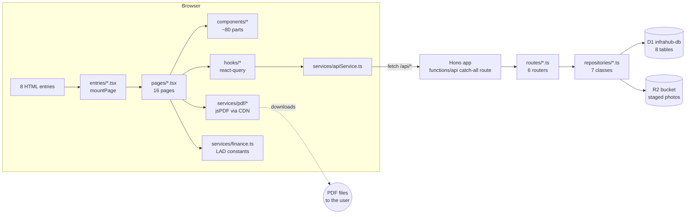
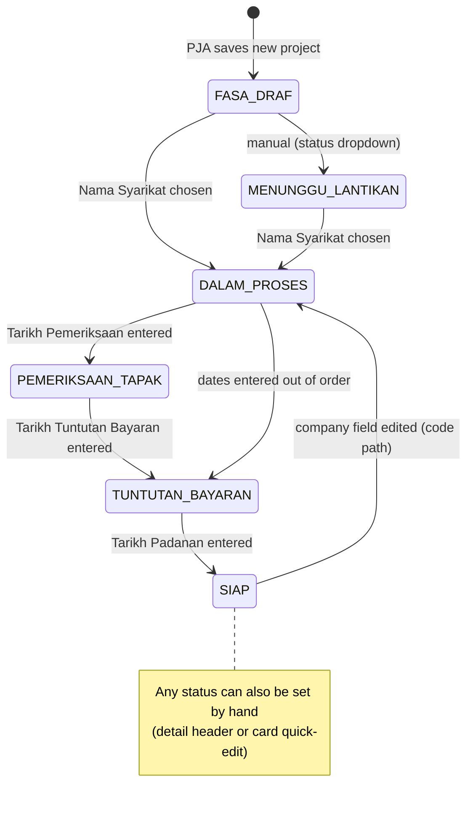
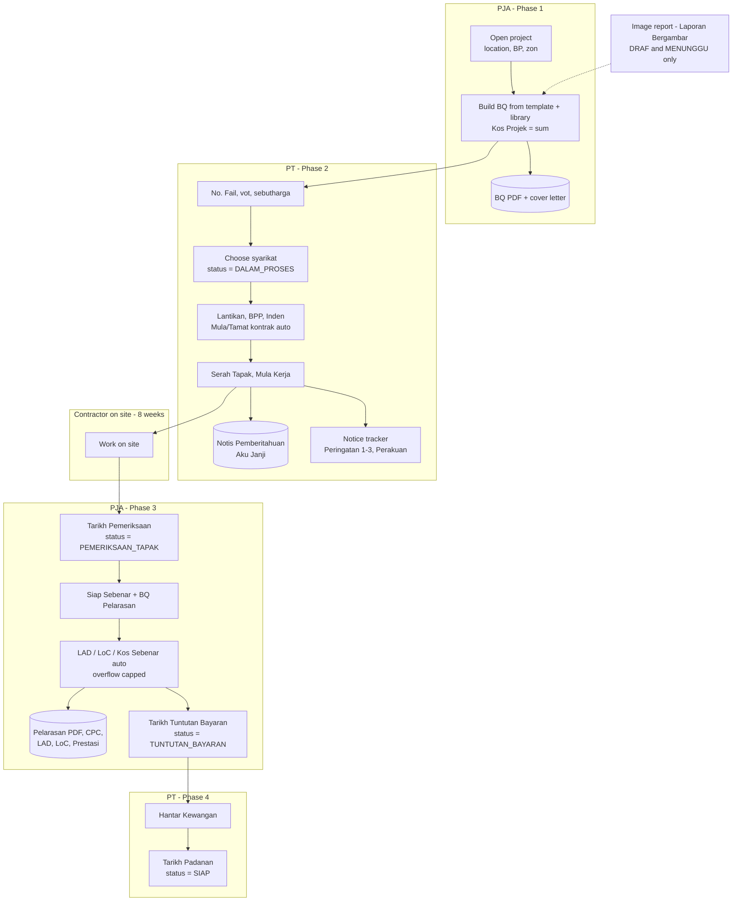

# InfraHub — system, workflow and live-data findings

Scope: how InfraHub is built, how a project moves from "opened" to "SIAP", who does what, and what the local copy of the live database (snapshot 2026-11-20 06:46 +08, 489 projects) says about how the workflow behaves in practice.
Labels: **[V]** = verified (file:line or a query I ran), **[I]** = my inference. Security is out of scope by the owner's instruction. Company names, staff names and usernames are not used; companies are "Syarikat A/B…", staff are "PJA 1/2…".

## 1. Summary

- **One site, eight pages, one big form.** InfraHub is a React 19 + Vite multi-page app (8 HTML entries) on Cloudflare Pages, talking to a small Hono API (6 route files, 7 repositories) over D1 (SQLite) and R2 (photos). About 25,500 lines of TypeScript; five files are over 1,500 lines and one of them, `ProjectDetail.tsx`, is where almost all workflow rules live. [V]
- **The workflow is a stored label, not a process engine.** `status` is a text column. Four form-field edits set it automatically (company chosen → DALAM_PROSES; Tarikh Pemeriksaan → PEMERIKSAAN_TAPAK; Tarikh Tuntutan → TUNTUTAN_BAYARAN; Tarikh Padanan → SIAP). The first step (FASA_DRAF → MENUNGGU_LANTIKAN) is manual only. Nothing records who changed what or when; the only history is one `updated_at` per project. [V: `pages/ProjectDetail.tsx:870-891`, grep for MENUNGGU_LANTIKAN]
- **The slow part of the journey is paperwork, not the site.** For the 293 finished (SIAP) projects the median is 118 days from opening to Pemadanan: 16 days to contract start, 38 days on site (hand-over to completion), then **62 days from completion to Pemadanan** (20 days to submit the claim, 33 days to reach Kewangan, 4 days to match). Site work is roughly a third of elapsed time. [V: section 5]
- **Work is spread almost perfectly evenly across companies.** 59 of 63 company names have exactly 7 projects, and each sits at RM 198,650–200,050 total against the RM 200,000 cap (Gini of project count 0.04). That looks like a planned allocation, not demand. The cap is only *reported* by the app (Senarai PDF), not enforced when a company is chosen. [V for the numbers; I for "planned"]
- **Money rules live inside UI effects and are partly duplicated.** Contract sum, LAD, LoC, Kos Sebenar and the capped overflow (`bq_pelarasan_extra`) are computed in React `useEffect`s in the project form and written back into the record. 223 of 339 claimed/finished projects carry an overflow (RM 238,757 in total, median RM 583) that the cap silently removes from payment. Vote balances are computed on the Projek page from the *currently filtered* list. [V]
- **Biggest overhaul risks:** (1) one global BQ master with copies stored inside 13.4 MB of JSON blobs, (2) two near-duplicate BQ editors (54 % of non-trivial lines identical), (3) money and date rules embedded in a 1,790-line form with no tests, (4) no history/audit trail, (5) several half-removed features (notifications, "realtime", PWA, 8 unused dependencies). Ranked table in section 6.

## 2. Architecture

### 2.1 Stack and how the pieces connect [V]

| Layer | What | Where |
|---|---|---|
| Entry pages (8) | `index/login/dashboard/projects/project/report/users/profile/settings.html`, each loads `entries/<page>.tsx` which calls `mountPage()` (React root + react-query client) | `vite.config.ts:31-41`, `lib/mountPage.tsx` |
| Page components | `pages/*.tsx` (16 files): Dashboard, ProjectsList, ProjectDetail (4-phase form), BQEditor, BQPelarasanEditor, 4 certificate pages, NotisGenerator, AkuJanjiEditor, ImageReportGenerator, AdminSettings, Users, Profile, Login | `pages/` |
| UI parts | `components/` (≈80 files): AppShell + Sidebar, mobile cards/bottom-sheets, BQ helpers, settings sub-screens | `components/` |
| Data hooks | `hooks/useProjects` (react-query, key `['projects','v126']`, optimistic update/rollback), `useSettings(year)`, `useUsers`, `useBulletins`, `useTemporaryGallery` | `hooks/` |
| API client | `services/apiService.ts` — one class, `fetch('/api/…')`, ~50 methods; helper `request()` | `services/apiService.ts:1-385` |
| API | Hono app at `/api`, 6 sub-routers: projects, users, bulletins, system (settings, library_groups, templates), storage (R2 photos), notifications | `functions/api/[[route]].ts`, `routes/*.ts` |
| Repositories | `ProjectRepository` maps ≈66 camelCase fields ⇄ snake_case columns from ONE field table (`PROJECT_FIELDS`), list view omits the heavy JSON columns | `functions/api/repositories/ProjectRepository.ts:11-189` |
| Storage | D1 database `infrahub-db` (binding `DB`), R2 bucket `infrahub-bucket` (binding `BUCKET`) | `wrangler.toml` |
| PDFs | Generated in the browser: `services/pdf/*` (11 files) using jsPDF from a **CDN `<script>`** (`window.jspdf`), autotable plugin, html2pdf from CDN | `index.html:61-67`, `services/pdf/PDFBaseHelper.ts:9-24` |
| Other client libs | exceljs (library → Excel export, lazy), pdfjs-dist (Import Inden PDF parser, lazy), lucide-react icons; Tailwind from a 407 KB runtime script `public/tailwind.js` (not a build step) | `lib/bqExport.ts`, `services/indenPdfLoader.ts`, `dashboard.html:25` |

Year handling: the "year" selector is `?year=` in the URL. Projects are **not stored with a year**; each entry page filters the full project list by `new Date(tarikhBuka).getFullYear() === selectedYear`. The year also selects which `system_settings` row (companies, votes, sebutharga numbers) is used. [V: `entries/projects.tsx:15-18`, `entries/dashboard.tsx:17-19`]

Caching: react-query with `staleTime 0`, `gcTime 5 min`, refetch on focus/reconnect; the server sets `no-store` on `/projects/*` and `/system/*`. Every page load fetches **all** projects of **all** years (blob columns excluded); the project page fetches the full record with blobs. [V: `lib/createQueryClient.ts`, `functions/api/[[route]].ts:30-37`, `ProjectRepository.ts:97-103`]

### 2.2 Things the repo advertises but the code does not do [V]

- **No offline/PWA behaviour.** `manifest.json` exists, but `public/sw.js` is a self-destructing worker and `index.html:430-440` unregisters any worker and reloads. The react-query *persister* packages are installed but imported nowhere.
- **No Supabase / realtime.** `@supabase/supabase-js` is a dependency, but nothing imports it; `api.channel()` in `apiService.ts:376-385` is a mock that immediately reports "SUBSCRIBED". `SyncStatus` and `useSettings` therefore show a realtime state that is always true.
- **Unused dependencies:** `recharts`, `@react-pdf/renderer`, `konva`, `react-konva`, `use-image`, `@supabase/supabase-js`, both query-persist packages — zero imports each (grep over `*.ts/*.tsx/*.html`, excl. node_modules/dist).
- **Notifications:** table `user_notification_states` (242 rows), 3 API routes and `apiService` methods exist; **no page or component calls them**. Row ids look like `p1-…/p2-…/p3-…/deadline-…`, i.e. they were generated for the notice deadlines by an earlier UI.

### 2.3 Component inventory (line counts via `wc -l`)

```csv
area,files,lines
pages,16,13335
components (root),14,1495
components/admin(+settings),23,1096
components/bq,12,857
components/dash,7,284
components/detail,11,514
components/projects,7,436
components/report,6,255
hooks,5,419
lib,10,875
services,7,711
services/pdf,11,3485
functions/api/routes,6,337
functions/api/repositories,7,726
entries,8,230
```

Total ≈ 25,500 lines across ≈ 150 TypeScript files (no test files exist). Largest files:

| Lines | File | What it holds |
|---:|---|---|
| 2,043 | `pages/BQEditor.tsx` | Contract-BQ builder (bills, items, calculation parts, library picker, templates) |
| 1,790 | `pages/ProjectDetail.tsx` | The 4-phase project form + all auto-calculation effects |
| 1,766 | `pages/BQPelarasanEditor.tsx` | Same editor again for the adjusted BQ |
| 1,729 | `pages/ImageReportGenerator.tsx` | Photo-report designer (canvas annotation, layouts, PDF) |
| 1,518 | `pages/ProjectsList.tsx` | Project table/cards, filters, vote & company summaries, 2 PDF exports |
| 1,467 | `pages/AdminSettings.tsx` | Companies, votes, sebutharga, BQ library, templates, meeting data |
| 932 | `pages/Dashboard.tsx` | Status tiles, worklist, notice warnings, bulletin board |
| 875 / 824 | `services/pdf/NotisPDFExporter.ts` / `BQPDFExporter.ts` | Five notice letters / cover letter + BQ + Pelarasan PDFs |

### 2.4 API surface [V: `functions/api/routes/*.ts`]

| Prefix | Methods | Purpose |
|---|---|---|
| `/api/projects` | GET list, GET :id, POST, PUT :id, DELETE :id | project CRUD (PUT updates only fields present in the body; no version check) |
| `/api/system/settings/:year` | GET, PUT | per-year settings row (whole row rewritten by the client) |
| `/api/system/library_groups` | GET, PUT | the **global** BQ library; PUT replaces the whole set |
| `/api/system/templates` (+ DELETE :id) | GET, PUT, DELETE | BQ starter templates |
| `/api/users` | list / add / update / delete | user directory |
| `/api/bulletins` | GET, POST, PUT :id/read, PUT :id/react, DELETE | dashboard notice board with read receipts + emoji reactions |
| `/api/storage` | gallery list, upload, file, location, delete, cleanup | R2 photo staging for Laporan Bergambar (rows older than 24 h are purged by `cleanup()`, triggered whenever the photo hook `useTemporaryGallery` mounts, i.e. on the image-report page) |
| `/api/notifications` | GET, PUT, DELETE | unused (see 2.2) |

### 2.5 Diagram



## 3. Data model

### 3.1 Tables (live row counts, local copy)

```csv
table,rows
app_users,16
bulletins,3
library_groups,107
templates,9
projects,489
system_settings,3
temporary_gallery,7
user_notification_states,242
```

| Table | Purpose | Key columns | JSON blob columns (shape) |
|---|---|---|---|
| `projects` | One row per work order ("project"). 69 columns | `id` (= `Date.now()` at creation), `status`, `tarikh_*` (12 date columns, all text `YYYY-MM-DD` — verified all 489 rows are length 10), `kos_projek`, `kos_sebenar`, `no_fail`, `no_inden`, `no_bpp`, `no_vote`, `no_sebutharga`, `nama_syarikat` (plain text), `pja_id` | see 3.2 |
| `system_settings` | **One row per year** (3 rows: 2024 empty, 2025, 2026) | `year` | `companies` string[] (60 in 2026); `company_order` string[]; `company_details` `{name → CompanyDetail}` incl. per-company `limit` (RM 200,000 for all); `vote_numbers` `VoteDefinition[]` `{code,name,allocation}` (10 in 2026); `sebutharga_numbers` string[]; `manual_financials` `{outsource,ydp}` (typed by hand, both 0); plus `meeting_date`, `meeting_number` |
| `library_groups` | **The global BQ master**: 107 groups / 196 items / 55 items with variants; 17 categories | `id`, `title`, `category` | `items` PresetItem[] `{id, description, rate?, unit?, variants[{id,label,rate,unit}]}` — no year, no contract/sebutharga field |
| `templates` | Starter bills for a new BQ (9: 1 EMPTY, 3 PERMULAAN_BASIC, 5 CUSTOM) | `id`, `key`, `order_index` | `bills` `{id,title,items:(ref|BQItem)[]}[]`; `group_refs` (legacy, `[]` in all 9) |
| `app_users` | 16 staff accounts: 2 ADMIN, 2 JURUTERA, 12 PJA | `id`, `role`, `jawatan`, `bahagian`, `unit` (feed the BQ cover page) | — |
| `bulletins` | Notice board (3 rows) | `id` text | `read_by` number[]; `reactions` `{emoji → userId[]}` |
| `temporary_gallery` | Staged photos for the image report (7 rows, 24 h life) | `id`, `image_url` (R2 key), `project_id?`, `location_tag` | — |
| `user_notification_states` | Read/deleted flags per user per generated notification id (242 rows; no UI uses it) | `(user_id, notification_id)` | — |

No foreign keys, no secondary indexes (only primary-key/unique auto-indexes), no `ALTER`-style migration history in the repo (`schema.sql` begins with `DROP TABLE`). [V: `schema.sql`, `sqlite_master` query]

### 3.2 JSON blobs inside `projects` (what they hold)

| Column | Shape (types.ts) | Live stats |
|---|---|---|
| `bq_data` | `BQGroup[]` → `{id,title,calculationId,locationIds[]|locationId,items:BQItem[]}`; `BQItem` = `{type:HEADER|ITEM|NOTE, description, unit, rate, qty, amount, calculationParts[{length,width,depth,multiplier,has*,isGlobal,globalIndex}], sourceGroupId, sourceItemId, sourceVariantId, customCalc…}` | 7.46 MB over 489 rows; median 14.8 KB, max 30.7 KB; 1,734 groups, 22,417 rows of which 8,672 are ITEM rows |
| `bq_data_pelarasan` | same shape, a **copy** of `bq_data` made by "Mulakan Pelarasan" (`ProjectDetail.tsx:594-614`), then edited; added items flagged `isAdjustment` | 5.96 MB; 358 projects have one; 1,328 groups; 6,991 ITEM rows |
| `project_locations` | `{id,lokasi,aduan}[]` (1–7 per project; the structured replacement for `lokasi`/`aduan`) | 489/489 filled |
| `global_calculations`, `global_calculations_pelarasan` | `{calculationId → GlobalDimensions[]}` where `GlobalDimensions = {length,width,depth,label?}` | 487 / 358 non-empty |
| `prestasi_scores` | number[6] (scores 1–10) for the Prestasi certificate | up to 19 bytes |
| `global_dimensions`, `location_dimensions`, `location_dimensions_pelarasan` | legacy dimension stores | see 3.3 |

Every ITEM row in both BQ blobs carries `sourceItemId` (8,672/8,672 and 6,991/6,991). That id is the **only** link back to the library; rates are copied by value. [V: `raw/measure_extra.py`] (Library vs contract question: see the BQ-model sibling report.)

```csv
metric,value
projects,489
bq_data_total_bytes,7463104
bq_data_pelarasan_total_bytes,5955023
bq_data_median_bytes,14785
bq_data_max_bytes,30729
bq_pelarasan_max_bytes,38200
contract_bq_groups,1734
contract_bq_rows_all_types,22417
contract_bq_ITEM_rows,8672
contract_ITEM_with_sourceItemId,8672
pelarasan_groups,1328
pelarasan_rows_all_types,17951
pelarasan_ITEM_rows,6991
pelarasan_ITEM_isAdjustment,489
groups_with_only_legacy_locationId_contract,318
groups_with_locationIds_contract,928
groups_with_only_legacy_locationId_pelarasan,357
groups_with_locationIds_pelarasan,611
items_with_legacy_hasLength_dimLength,0
projects_globalDimensions_all_zero,489
projects_location_dimensions_nonempty,1
projects_global_calculations_nonempty,487
projects_global_calculations_pelarasan_nonempty,358
projects_project_locations_nonempty,489
aduan_text_column_nonempty,0
templates_group_refs_nonempty,0
```

### 3.3 Deprecated / legacy fields still present [V]

| Item | State in live data | Evidence |
|---|---|---|
| `projects.global_dimensions` / `GlobalDimensions` on Project | **All 489 rows hold `{0,0,0}`** — dead | query on `global_dimensions` |
| `projects.location_dimensions`, `…_pelarasan` | non-empty in **1** of 489 rows — effectively dead (replaced by `global_calculations*`) | `ld` query |
| `BQItem.hasLength/dimLength/…` (item-level dims) | present on **0** items; per-part flags live in `calculationParts` | `measure_extra.py` |
| Group `locationId` (single) vs `locationIds[]` | 318 contract groups and 357 pelarasan groups still use only the old single `locationId`; 928 / 611 use the array; the rest have neither | `measure_extra.py` |
| `projects.aduan` text column | **empty in all 489 rows** (replaced by `project_locations[].aduan`); `no_aduan` still used (477 filled) | length query |
| `projects.lokasi` | still filled in 487 rows next to `project_locations` (duplicate store) | length query |
| `templates.group_refs` | `[]` in all 9 templates | `tpl` query |
| `app_users.department` | legacy column kept "for compat" (`types.ts:97`) | code |
| Supabase | dependency + mock only, see 2.2 | grep |

### 3.4 Per-year settings model [V + I]

- One row per year; the year is chosen by URL param; `system_settings` for 2026 holds 60 panel companies, each with details and a cap (`limit` RM 200,000), 10 vote codes with allocations, and one sebutharga number (`MPS/SH/302/25`). 2025 has 3 companies / 6 votes; 2024 is an empty row.
- Companies are identified by **name text**: `projects.nama_syarikat` stores the name, not an id. Votes are identified by their code text in `projects.no_vote`. Renaming a company in Settings would orphan its projects. [I, from schema + `ProjectDetail` select]
- Projects belong to a settings year only by **calendar year of `tarikh_buka`**. 4 projects opened in Dec 2025 sit in the 2025 bucket (3 companies, each 1 project) even though they finished in 2026. [V]
- Each Settings save PUTs the full row; two admins saving different tabs at once would overwrite each other. [I]
- `no_sebutharga` is stored per project (420 rows `MPS/SH/302/25`, 1 each of two other values, 67 blank), so there is already a per-project contract reference — but nothing connects it to rates (BQ sibling report).

## 4. Workflow and pipeline

### 4.1 Roles (as the code uses them)

| Role | Count | Works on |
|---|---:|---|
| PJA (Pegawai/Penolong Jurutera, site officer) | 12 | Phase 1 *BQ Building* and Phase 3 *BQ Pelarasan*; sees only their own projects in lists; cover-page details (jawatan/bahagian/unit) come from the PJA's profile |
| ADMIN (PT, Pembantu Tadbir) | 2 | Phase 2 *File Creation* and Phase 4 *Penutup*; Settings workspace (companies, votes, BQ library); can edit the notice-status tracker |
| JURUTERA (signers) | 2 | Appear as signatories on Notis/Perakuan letters; may edit the notice-status tracker |

Tabs are labelled `1. BQ Building (PJA)`, `2. File Creation (PT)`, `3. Pelarasan (PJA)`, `4. Penutup (PT)` (`ProjectDetail.tsx:388-393`). [V]

### 4.2 What changes `status` [V: `ProjectDetail.tsx:870-891, 1012`; `CompanyCard.tsx:56`]

| Trigger | New status | Also sets | Kind |
|---|---|---|---|
| New project saved | FASA_DRAF | — | automatic default (`:326`, `:497`) |
| Status drop-down in the detail header or quick-edit on the project card | any of the 6 | — | **manual** (the only way to reach MENUNGGU_LANTIKAN) |
| Nama Syarikat chosen (any edit of that field with a value) | DALAM_PROSES | — | automatic, fires even on a SIAP project [I: code reading; not observable in data] |
| Tarikh Pemeriksaan entered | PEMERIKSAAN_TAPAK | Peratus Siap = 100 | automatic |
| Tarikh Tuntutan Bayaran entered | TUNTUTAN_BAYARAN | Peratus Siap = 100 | automatic |
| Tarikh Padanan entered | SIAP | Peratus Siap = 100 | automatic |
| Tarikh Siap Sebenar, Tarikh Hantar Kewangan | *(nothing)* | LAD days/amount recalculated (Siap Sebenar) | no status effect |
| A date cleared | *(nothing)* | — | status never moves backwards automatically |

Rules fire only on a field change in the form (`handleInputChange`). Values set by the Import Inden tool or the quick-edit select bypass them. The live data mostly matches the rules: 1 SIAP project has no Tarikh Padanan, no project has a Padanan date outside SIAP; but 2 projects have a Tuntutan date while still in an earlier status (section 5.8).

### 4.3 Swimlane: step × role × fields × documents

| Status (what it means) | Who works | Fields filled | Documents / certificates produced here |
|---|---|---|---|
| **FASA_DRAF** — PJA opens the file | PJA (Phase 1) | Nama Projek (forced UPPERCASE), Lokasi + Aduan rows (`project_locations`), No. Aduan, BP, Zon, Mukim, Tarikh Buka, PJA; BQ built from template + library → `bq_data`; **Kos Projek = Σ item amounts (auto)** | *BQ PDF* = cover letter (page 1, uses Cover Jawatan/Bahagian/Unit/Sebut Harga text) + bill pages (`BQPDFExporter.exportBQ`); *Image report* (Laporan Bergambar) is built here for DRAF/MENUNGGU projects |
| **MENUNGGU_LANTIKAN** — file opened, company not yet appointed | PT (Phase 2, start) | No. Fail (27 of 35 rows already have it), No. Vot, No. Sebutharga | *Image report* still available; status set **manually** |
| **DALAM_PROSES** — company appointed, work running | PT (Phase 2) | Nama Syarikat (triggers status), Bulan, Tarikh Lantikan, No. BPP, Tarikh Cetakan BPP, No. Inden (also bulk-importable from the supplier PO PDF via *Import Inden*), Tempoh Kontrak (weeks; 8 weeks in 420 rows), **Tarikh Mula Kontrak = BPP date + 2 working days** (unless manual), **Tarikh Tamat = Mula + tempoh**, Tarikh Serah Tapak, **ISO = working days BPP→Serah Tapak**, **Tarikh Mula Kerja = Serah Tapak + 2 working days** | *Notis Pemberitahuan*, *Aku Janji* (month, panel title, footer text editable), the *notice tracker* (Peringatan 1 at Tamat−7 d, Perakuan Kerja Tidak Siap at Tamat, Peringatan 2 at +7 d, Peringatan 3 at +14 d; each PENDING/SENT/NOT_REQUIRED) |
| **PEMERIKSAAN_TAPAK** — site finished, being inspected | PJA (Phase 3) | Tarikh Pemeriksaan (triggers status), Tarikh Siap Sebenar, Prestasi %, BQ Pelarasan built ("Mulakan Pelarasan" copies `bq_data`), Wang Tahanan | *BQ Pelarasan PDF*; **CPC (Siap Kerja)** — button disabled while any due notice is still PENDING (`isCPCBlocked`, `:536-576`); *Perakuan LAD* (late finish); *LoC* (late claim); *Prestasi* certificate (6 scores, Skop BEKALAN/PERKHIDMATAN/KERJA, No. Inbois) |
| **TUNTUTAN_BAYARAN** — claim lodged | PJA/PT | Tarikh Tuntutan Bayaran (triggers status); Kos Sebenar and overflow auto-computed | CPC/LAD/LoC/Prestasi re-printable; *Senarai* and *Rotasi* PDFs from the Projek page |
| **SIAP** — matched with Kewangan | PT (Phase 4) | Tarikh Hantar Kewangan (Pemadanan hand-over), Tarikh Padanan (triggers status) | none new; the project drops off the Dashboard worklist (`Dashboard.tsx:158`) |

Dashboard (`pages/Dashboard.tsx`): status tiles, a worklist of all non-SIAP projects (filter by PJA/status/search), a "pending notice" warning per project (`getPendingNotice`) and the bulletin board. **Vote balances are not on the Dashboard**; they are on the Projek page (below).

### 4.4 Money logic [V]

| Quantity | Rule | Where |
|---|---|---|
| Kos Projek | Σ `amount` of all contract BQ rows, rewritten whenever `bq_data` changes | `ProjectDetail.tsx:944-955` |
| LAD days | `max(0, Tarikh Siap Sebenar − Tarikh Tamat Kontrak)` | `:765-777` |
| LAD daily rate | contract < RM 20,000 → RM 20/day; else `sum × 6.4 % / 365`, rounded to sen. **Hard-coded again inline (`0.064`, `20000`) although `services/finance.ts` already defines the same constants** used by LAD/Notis PDFs | `services/finance.ts:5-22` vs `ProjectDetail.tsx:773` |
| LoC | `max(0, (Tarikh Tuntutan − Tarikh Siap) − 14) × RM 100`; active unless `isLocDeductionEnabled === false`. RM 100 and 14 days are hard-coded in 3 files | `ProjectDetail.tsx:779-798`, `LoCCertificate.tsx:17`, `LoCPDFExporter.ts:8` |
| Pelarasan total | Σ amounts of `bq_data_pelarasan` (falls back to Kos Projek if empty) | `:818-840` |
| **Capped** | `Kos Sebenar = max(0, min(Pelarasan, Kos Projek) − LAD − LoC − Wang Tahanan)`; `bq_pelarasan_extra = max(0, Pelarasan − Kos Projek)` (the overflow nobody pays) | `:841-847` |
| Harga Akhir (`getHargaAkhir`) | status TUNTUTAN/SIAP → `kos_sebenar` (fallback recomputation); before that → `kos_projek`. Used for table columns, company totals and vote "used" in *actual* view | `ProjectsList.tsx:323-343` |
| Vote balance (Projek page) | per `no_vote`: allocation (settings) vs Σ(`kos_projek` in *contract* view or Σ Harga Akhir in *actual* view); **Baki Bersih = total balance − manual "Lain-lain (Sebutharga)" − manual "Lantikan YDP/TYDP"**; computed from `filteredProjects`, i.e. changes with the on-screen filters | `ProjectsList.tsx:583-607, 1374-1394` |
| Company cap | `limit` in company details (RM 200,000); the Senarai PDF prints `limit − Σ contract` per company; **nothing blocks assigning more** | `ProjectsListPDFExporter.ts:38-65` |
| Wang Tahanan | free-typed RM per project; **0 of 489 rows use it** | data |

### 4.5 Diagrams





## 5. Live measurements (local D1 copy, snapshot 2026-11-20)

All dates are ISO `YYYY-MM-DD` text (checked: every non-empty date column has length 10 in every row). Year = calendar year of `tarikh_buka`, as the app does. "Days" are calendar days. Scripts: `raw/measure.py`, `raw/measure_extra.py`; CSV files in `raw/csv/`.

### 5.1 Funnel — projects per status per year

```csv
year,FASA_DRAF,MENUNGGU_LANTIKAN,DALAM_PROSES,PEMERIKSAAN_TAPAK,TUNTUTAN_BAYARAN,SIAP,total
2025,0,1,1,0,0,2,4
2026,29,34,53,32,46,291,485
```

2026: 291 of 485 projects (60 %) are SIAP; 131 are mid-process (DALAM_PROSES/PEMERIKSAAN_TAPAK/TUNTUTAN_BAYARAN) and 63 are still FASA_DRAF/MENUNGGU_LANTIKAN — see aging below.

### 5.2 Projects opened per month, and throughput of each milestone

```csv
month,projects_opened
2025-12,4
2026-01,90
2026-02,48
2026-03,33
2026-04,51
2026-05,39
2026-06,31
2026-07,58
2026-08,48
2026-09,28
2026-10,34
2026-11,25
```

```csv
month,opened,appointed,site_complete,claimed,matched
2025-12,4,3,2,1,1
2026-01,90,83,6,1,0
2026-02,48,41,24,15,0
2026-03,33,37,52,31,18
2026-04,51,41,54,51,30
2026-05,39,31,36,40,30
2026-06,31,42,26,28,54
2026-07,58,63,53,53,17
2026-08,48,32,39,37,53
2026-09,28,23,41,33,33
2026-10,34,28,22,37,28
2026-11,25,0,11,12,28
```

Opening rate is ~25–58/month after a 90-project January. `created_at` is **not** usable for timing: 176 rows were created in March 2026 (a bulk import) while their `tarikh_buka` spans January onwards. [V]

### 5.3 Time between milestones, SIAP projects (n = 293)

```csv
from,to,n,negative_n,p25,median,p75,p90,max
tarikh_buka,tarikh_lantikan,293,2,3.0,8.0,12.0,20.8,59
tarikh_lantikan,tarikh_cetakan_bpp,293,1,2.0,4.0,7.0,14.0,408
tarikh_cetakan_bpp,tarikh_mula_kontrak,293,1,2.0,3.0,4.0,4.0,4
tarikh_mula_kontrak,tarikh_serah_tapak,293,56,0.0,0.0,3.0,6.0,25
tarikh_serah_tapak,tarikh_pemeriksaan,293,2,28.0,38.0,49.0,56.0,141
tarikh_pemeriksaan,tarikh_siap_sebenar,293,13,0.0,0.0,0.0,0.0,14
tarikh_siap_sebenar,tarikh_tuntutan_bayaran,291,0,10.0,20.0,37.0,53.0,136
tarikh_tuntutan_bayaran,tarikh_hantar_kewangan,290,3,23.2,33.0,44.0,57.0,154
tarikh_hantar_kewangan,tarikh_padanan,292,0,2.0,4.0,5.0,6.0,17
tarikh_buka,tarikh_padanan,292,0,101.0,118.0,141.0,164.9,284
tarikh_buka,tarikh_tuntutan_bayaran,291,1,65.0,82.0,99.0,122.0,247
tarikh_lantikan,tarikh_siap_sebenar,293,1,39.0,49.0,60.0,66.0,554
tarikh_mula_kontrak,tarikh_tamat_kontrak,293,0,56.0,56.0,56.0,56.0,56
tarikh_tamat_kontrak,tarikh_siap_sebenar,293,252,-27.0,-14.0,-6.0,0.0,114
```

Reading guide: the "negative_n" column counts rows where the later date is *earlier* than the first (e.g. 56 SIAP rows have Serah Tapak before Mula Kontrak). Contract length is exactly 56 days (8 weeks) in all 293. The last row (`tamat → siap_sebenar`) is mostly negative on purpose (finished *before* the end date): 252 of 293 finished before the end date, 19 on the day, 22 after it.

Condensed to four phases (medians; sums of medians ≠ the median of the whole):

```csv
phase,from,to,n,p25,median,p75
Pre-contract admin (open to contract start),tarikh_buka,tarikh_mula_kontrak,293,12,16,22
Hand-over (open to site hand-over),tarikh_buka,tarikh_serah_tapak,293,14,18,23
On site (hand-over to completion),tarikh_serah_tapak,tarikh_siap_sebenar,293,28,38,49
Post-site paperwork (completion to matching),tarikh_siap_sebenar,tarikh_padanan,292,48,62,74.25
Whole journey (open to matching),tarikh_buka,tarikh_padanan,292,101,118,141
```

**Backlog aging** (days since the date that defines the status, at snapshot):

```csv
status,reference_date,n,p25,median,p75,max
FASA_DRAF,tarikh_buka,29,7.0,17.0,107.0,298
MENUNGGU_LANTIKAN,tarikh_buka,35,18.0,30.0,39.0,324
DALAM_PROSES,tarikh_mula_kontrak,53,37.0,53.0,74.0,158
PEMERIKSAAN_TAPAK,tarikh_pemeriksaan,29,16.0,32.0,45.0,135
TUNTUTAN_BAYARAN,tarikh_tuntutan_bayaran,46,23.0,39.0,46.0,106
```

### 5.4 Projects per BP and per Zon

```csv
bp,projects
BP 4: SELAYANG-GOMBAK BARAT,165
BP 5: KEPONG-SUNGAI BULOH,96
BP 7: RAWANG UTARA,76
BP 6: RAWANG TIMUR,48
BP 8: RAWANG BARAT,30
BP 1: GOMBAK UTARA,30
BP 3: GOMBAK SELATAN,19
BP 9: RAWANG SELATAN,13
-,5
(kosong),5
BP 2: PERMATANG KUARZA,2
```

```csv
zon,projects_touching_zon
Zon 24,50
Zon 4,42
Zon 14,38
Zon 7,36
Zon 15,31
Zon 10,30
Zon 18,30
Zon 19,29
Zon 17,28
Zon 11,26
Zon 12,26
Zon 5,20
Zon 16,18
Zon 2,16
Zon 20,16
Zon 23,16
Zon 6,16
Zon 22,14
Zon 8,13
Zon 21,11
Zon 3,9
Zon 9,9
(kosong),8
Zon 13,6
Zon 1,4
```

49 projects list several zones in the single free-text `zon` field (e.g. "Zon 7, Zon 10"), so the zon counts above count a project once per zone it touches (sum > 489). BP 4 and BP 5 hold 53 % of all projects.

### 5.5 Money: Kos Projek distribution and totals

```csv
rm_band,FASA_DRAF,MENUNGGU_LANTIKAN,DALAM_PROSES,PEMERIKSAAN_TAPAK,TUNTUTAN_BAYARAN,SIAP
0-5000,3,0,1,0,0,0
5000-10000,2,1,0,0,0,0
10000-20000,7,1,5,2,2,49
20000-50000,15,33,48,30,44,244
50000-100000,0,0,0,0,0,0
100000-150000,0,0,0,0,0,0
150000-200000,1,0,0,0,0,0
>=200000,1,0,0,0,0,0
```

```csv
status,projects,sum_kos_projek_rm,median_kos_projek_rm,sum_kos_sebenar_rm,n_with_kos_sebenar
FASA_DRAF,29,2226644.01,23840.12,2226644.01,29
MENUNGGU_LANTIKAN,35,1054623.51,30123.07,1054623.51,35
DALAM_PROSES,54,1595970.27,30486.76,1583881.76,54
PEMERIKSAAN_TAPAK,32,996845.13,31053.08,984265.88,32
TUNTUTAN_BAYARAN,46,1336835.2,29402.1,1312102.38,46
SIAP,293,8140831.8,27881.88,8016457.49,293
```

Overall: median Kos Projek RM 29,111 (p25 23,908, p75 33,887); total RM 15.35 million across 488 priced projects; 1 project has no price. Almost all projects (≥ 95 %) sit between RM 10,000 and RM 50,000 — the sizes are shaped by the cap and by the 7-projects-per-company pattern. Two drafts are outliers (one RM 150–200k, one above RM 200k; max RM 1.48 million).

```csv
metric,value
projects_in_TUNTUTAN_or_SIAP,339
sum_kos_projek_rm,9477667.0
sum_kos_sebenar_rm,9328559.87
sum_bq_pelarasan_extra_rm_uncapped_overflow,238756.84
projects_with_overflow_gt_0,223
overflow_median_rm,583.34
overflow_p75_rm,1360.42
overflow_max_rm,12323.11
projects_with_LAD,31
sum_lad_rm,4180.67
lad_days_median,15
projects_with_LoC,1
sum_loc_rm,2100
projects_with_wang_tahanan,0
```

### 5.6 Workload — projects per PJA (anonymised, sorted) and per company

```csv
pja,projects_total,projects_not_siap
PJA 1,107,50
PJA 2,78,32
PJA 3,65,16
PJA 4,61,15
PJA 5,55,3
PJA 6,48,8
PJA 7,28,26
PJA 8,21,21
PJA 9,18,17
PJA 10,5,5
PJA 11,2,2
PJA 12,1,1
```

PJA 1 carries 107 projects (22 %); PJA 1–4 carry 311 (64 %); PJA 7–9 have almost nothing finished (their projects are mostly still open — probably recently assigned) [I].

Companies (63 distinct names used; 60 in the 2026 panel + 3 from 2025):

```csv
projects_per_company,n_companies
1,3
7,59
8,1
```

```csv
year,companies_used,companies_over_200k,max_pct_of_cap,median_pct_of_cap
2025,3,0,12.3,8.8
2026,60,1,100.0,99.9
```

`projects_per_company.csv` lists each anonymised company: 59 companies have 7 projects (RM 198,653–200,051), 1 has 8 projects (RM 199,991), and 3 have 1 project (the 2025 batch). Gini of project count 0.043; Gini of RM 0.045 — nearly perfectly equal. 65 projects (drafts and waiting) have no company yet. One company exceeds the cap by RM 50.67 (RM 200,050.67). [V]

### 5.7 Vote allocation vs committed (2026 settings, 2026 projects)

```csv
vote_code,vote_name,allocation_rm,projects,committed_kos_projek_rm,spent_net_rm,balance_rm,pct_used
(tiada vot),(not in settings),,63,3273465.07,3273465.07,,
267010,Bahan Pengecat,104840,1,37870.0,37113.04,67726.96,35.4
272040,Bekalan Papan Tanda,550100,17,504078.68,498116.49,51983.51,90.6
282010,Kemudahan Perkhidmatan Infrastruktur (CP),540000,17,566408.44,562643.4,-22643.4,104.2
282030,Penyelenggaraan Longkang Besar,750000,23,749344.54,735702.98,14297.02,98.1
282050,Penyelenggaraan Jalan & Lorong,492500,15,489212.8,483119.74,9380.26,98.1
282090,Pembinaan Longkang,8176500,294,8221821.14,8128047.64,48452.36,99.4
282130,Infra dan Kemudahan Awam,600000,23,603083.23,598822.4,1177.6,99.8
282180,Penyelenggaraan Perhentian Bas,127050,5,127046.86,127046.86,3.14,100.0
331100,Membina Pondok Bas,97900,3,97704.35,97704.35,195.65,99.8
948060,Wang Amanah (ISF),629898.45,24,629898.45,611210.32,18688.13,97.0
```

`committed` = Σ Kos Projek; `spent_net` uses Kos Sebenar for TUNTUTAN/SIAP projects, Kos Projek otherwise (same rule as the Projek page). Two votes are committed above their allocation on contract values (282010 by RM 26.4k, 282090 by RM 45.3k); on net spent, 282010 is over by RM 22.6k and 282090 is within RM 48.5k of its allocation; 63 draft/waiting projects have no vote yet (RM 3.27 m, not yet charged to any vote).

### 5.8 Data-quality checks

```csv
check,rows_flagged
later_status_missing_no_fail,0
later_status_missing_no_inden,4
later_status_missing_no_vote,0
later_status_missing_company,1
later_status_missing_no_bpp,1
later_status_missing_tarikh_lantikan,1
company_set_but_status_before_DALAM_PROSES,0
SIAP_without_tarikh_siap_sebenar,0
SIAP_without_tarikh_padanan,1
SIAP_without_bq_pelarasan,0
padanan_set_but_not_SIAP,0
tuntutan_set_but_status_before_TUNTUTAN,2
pemeriksaan_set_but_status_before_PEMERIKSAAN,0
SIAP_without_tarikh_hantar_kewangan,1
kos_sebenar_gt_kos_projek,0
kos_sebenar_zero_or_null_on_TUNTUTAN_SIAP,0
bq_pelarasan_extra_gt_0,233
kos_projek_zero_or_null,1
date_order_violation_buka_after_lantikan,4
date_order_violation_lantikan_after_cetakan_bpp,1
date_order_violation_mula_kontrak_after_serah_tapak,71
date_order_violation_serah_tapak_after_pemeriksaan,2
date_order_violation_pemeriksaan_after_siap_sebenar,16
date_order_violation_siap_sebenar_after_tuntutan_bayaran,0
date_order_violation_tuntutan_bayaran_after_hantar_kewangan,3
date_order_violation_hantar_kewangan_after_padanan,0
padanan_not_equal_hantar_kewangan,286
duplicate_no_fail_among_nonblank,0
duplicate_no_inden_rows_among_nonblank,0
bp_blank_or_dash,10
zon_blank,8
zon_multiple_in_one_text_field,49
mukim_blank,15
aduan_text_column_nonempty,0
no_aduan_blank,13
status_vs_peratus_siap_mismatch_(SIAP but <100),1
SIAP_tarikh_siap_after_tamat_kontrak_(late),22
lad_amount_gt_0,31
loc_amount_gt_0,1
wang_tahanan_gt_0,0
is_loc_deduction_enabled_true,0
is_manual_mula_kontrak_true,2
is_tiada_notis_diperlukan_true,3
SIAP_with_any_notice_PENDING_or_SENT_(n1),52
possible_test_name_(UJI/TEST/DUMMY),1
very_short_name_(<10 chars),4
no_sebutharga_differs_from_2026_current,0
no_sebutharga_blank_on_later_status,3
```

Highlights:
- **Required-by-stage gaps are small:** 4 later-status projects without No. Inden, 1 without company, 1 without No. BPP, 1 without Tarikh Lantikan, 3 later-status projects without sebutharga number. No missing No. Fail on later statuses, 0 duplicate No. Fail/No. Inden.
- **SIAP integrity:** 0 SIAP without Siap Sebenar, 1 without Padanan, 1 without Hantar Kewangan, 1 without BQ Pelarasan, 1 with Peratus Siap < 100.
- **Date order:** 71 rows with Serah Tapak before Mula Kontrak (24 % of rows having both; may be legitimate hand-over practice [I]), 16 with Pemeriksaan after Siap Sebenar, 4 with Lantikan before Buka, 3 with Hantar Kewangan before Tuntutan. In 275 of 293 SIAP rows Tarikh Pemeriksaan **equals** Tarikh Siap Sebenar — they are effectively one event typed twice.
- **Status vs dates:** 2 projects hold a Tuntutan date while in an earlier status.
- **Money:** 0 rows with Kos Sebenar > Kos Projek (the cap works); 233 rows carry an overflow (223 in TUNTUTAN/SIAP + 10 in earlier statuses where Pelarasan has been started); LAD on 31 projects (22 SIAP) RM 4,181 total, median 15 days; LoC on 1 project (RM 2,100); `is_loc_deduction_enabled` = 0 on **all** rows although the code treats "not false" as enabled; Wang Tahanan on none.
- **Notices:** Peringatan 1 is SENT on 66 projects (52 of them SIAP), Perakuan Kerja Tidak Siap SENT 28, Peringatan 2 SENT 22, Peringatan 3 SENT 15; 3 projects are marked "Tiada notis diperlukan". Most projects have all four left at PENDING (417 / 447 / 466 / 472), so the tracker is used only for the late/early-warning cases.
- **Classification:** 10 with BP blank or "-", 8 without zone, 15 without mukim, 13 without No. Aduan.
- **Test records:** 1 project name matches TEST/UJI/DUMMY patterns; 4 names are under 10 characters (worth a manual look). Counts are of rows, not names.

## 6. Pain points and technical debt (non-security, ranked by impact)

| # | Pain point | Evidence | Why it matters for an overhaul |
|---:|---|---|---|
| 1 | **One global BQ master; projects copy rates by value into JSON** | `library_groups` has no year/sebutharga field; every ITEM row has `sourceItemId`; `bq_data` 7.5 MB + `bq_data_pelarasan` 6.0 MB | A new/different contract cannot be represented. Changing a library rate never reaches existing projects, and old rates cannot be traced to a contract. (Deep dive: BQ sibling report.) |
| 2 | **Workflow is implicit and unaudited** — `status` set by field side-effects; one manual step; no history | `ProjectDetail.tsx:870-891`; only `updated_at`; no history table | Impossible to answer "who moved this, when", to measure true waiting time, or to add approvals without rewriting the form. Date columns are the only trace (and 71+16+… are out of order). |
| 3 | **Money and date rules live inside a 1,790-line form** (26 `useState`, 20 `useEffect`, results written back into state and saved) | `ProjectDetail.tsx:765-890`; LAD constants duplicated vs `finance.ts`; `getHargaAkhir` re-implemented in `ProjectsList.tsx` | Rules are untestable, easy to break, and two screens can disagree. **No test files exist in the repo.** Any change to LAD/LoC/cap logic has to be found by reading code. |
| 4 | **Two near-copies of the BQ editor** | `BQEditor.tsx` 2,043 lines vs `BQPelarasanEditor.tsx` 1,766; 588 of 1,085 non-trivial lines of the first also appear verbatim in the second (54 %); 41 of 46 function names shared | Every BQ rule must be changed twice; mobile cards are duplicated as well (`BQItemCardMobile` / `PelarasanItemCardMobile`). Highest regression risk during a UI rebuild. |
| 5 | **Large JSON blobs instead of tables** | 22,417 BQ rows in 489 blobs; `project_locations`, `prestasi_scores`, `global_calculations` are JSON | No cross-project questions ("how much Longkang was built this year", "which items overrun") without parsing every blob; whole-blob rewrites on every save; every project fetch carries up to 38 KB. |
| 6 | **Per-year settings in one blob row; companies and votes referenced by text** | `system_settings` JSON columns; `nama_syarikat`/`no_vote` are text | Renaming a company or vote orphans projects; whole-row PUT is last-write-wins; company cap not enforced (1 company RM 50 over); manual financial deductions are typed by hand. |
| 7 | **Money views depend on UI filters** | Vote summary uses `filteredProjects` (`ProjectsList.tsx:589`) | The "balance" can change when a user filters the table; two votes already show committed > allocation. |
| 8 | **Code and data disagree / dead legacy** | `global_dimensions` 489/489 zeros; `aduan` column empty; `location_dimensions` 1/489; LoC flag 0 on all rows but 1 row has LoC; `group_refs` all empty; 318+357 legacy `locationId` groups | The overhaul must migrate or delete these deliberately; "empty" columns still shape the API (≈66-field mapper). |
| 9 | **Half-removed features that look alive** | notifications table/API (242 rows, no UI); mocked "realtime" status; PWA manifest + self-destructing SW; 8 unused dependencies | Misleads maintainers, inflates the bundle, and hides what really needs rebuilding. |
| 10 | **Waiting time is invisible** | 62-day median completion→Pemadanan; Dashboard only warns about contract-end notices | The slowest part of the pipeline (claim preparation 20 d, Kewangan hand-over 33 d) has no owner, no reminder and no screen. |
| 11 | **Free-text classification** | zon holds "Zon 7, Zon 10" in 49 rows; BP/mukim blank in 10/15; BP stored as the display string | Reporting per BP/zon is approximate; filters cannot be exact. |
| 12 | **Runtime dependency on CDNs and a 407 KB Tailwind runtime script** | `index.html:61-67`, `public/tailwind.js` | PDF generation needs the CDN copy of jsPDF at runtime; styles are compiled in the browser; builds are not self-contained. |
| 13 | **Duplicated mobile components and hooks** | `useIsMobile` ×3 (`lib`, `components/bq`, `components/detail`), `PjaAvatar` ×2, `MobilePager` ×2, `ProjectCard` ×2 | A mobile-first redesign must pick one set; otherwise fixes diverge again. |
| 14 | **No concurrency guard on project saves** | `ProjectRepository.update` updates the sent fields without comparing `updated_at` | PJA (Phase 1/3) and PT (Phase 2/4) edit different sections of the same row; a full-form save from a stale tab could overwrite the other role's fields. [I] |
| 15 | **Hard-coded document constants** | LAD/LoC rates, 14-day grace, slogans, letter paragraphs inside exporters | Policy changes (new pekeliling) need code edits and a release. |

## 7. Open questions for ar-Raqmi

1. **MENUNGGU_LANTIKAN** is only set by hand. Should it follow automatically when PT enters No. Fail (27 of 35 waiting projects already have one)?
2. **Pemeriksaan vs Siap Sebenar:** they are the same date in 94 % of finished projects. Are they really one event, or should the app ask for both?
3. **Serah Tapak before Mula Kontrak** appears in 71 rows. Is early hand-over allowed, or is it a typing/ISO-count habit?
4. **Seven projects per company at ≈ RM 200k** looks planned. Is the allocation fixed in advance (a rota), and would you like the app to enforce or suggest it?
5. **LoC:** the switch is off in all rows, yet one project carries a RM 2,100 LoC. Is LoC currently in use? **Wang Tahanan** is used by none — keep, hide, or remove?
6. **Votes:** 282010 and 282090 are committed above allocation. Is that acceptable (reallocation between votes), and who approves it?
7. **After Tuntutan** (median 33 days to Kewangan, then 4 days to Padanan): is the wait inside MPS, inside Kewangan, or waiting for documents? Who should be reminded?
8. **Next contract:** when a new sebutharga starts (e.g. 2027, new rates), do old projects keep their original rates, and may two contracts run in parallel within one year?
9. **Photos** are deleted after 24 hours. Is that intended, or should the Laporan Bergambar photos be kept with the project?
10. **Notifications / notice reminders:** the earlier notification feature (Peringatan 1–3 deadlines) is no longer shown anywhere. Do you want it back?
11. Which of the documents (BQ, Pelarasan, Aku Janji, 5 notice letters, CPC, LAD, LoC, Prestasi, image report, Senarai/Rotasi) must the new design keep identical in layout (they follow government formats), and which can be redesigned?
12. 65 projects have no company (64 in FASA_DRAF/MENUNGGU_LANTIKAN + 1 later-stage). Are all genuinely waiting for appointment, or are some cancelled? (There is no "Dibatalkan" status.)
